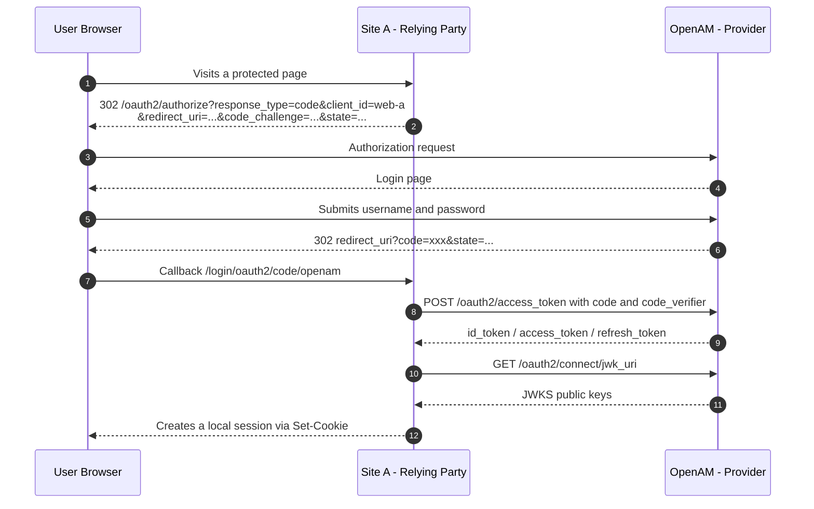
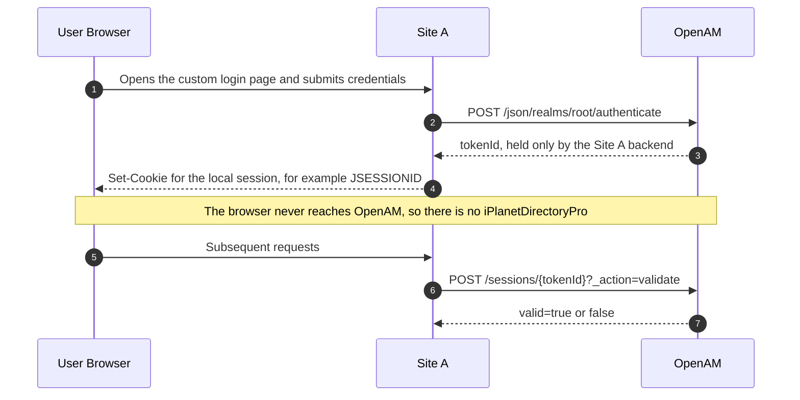
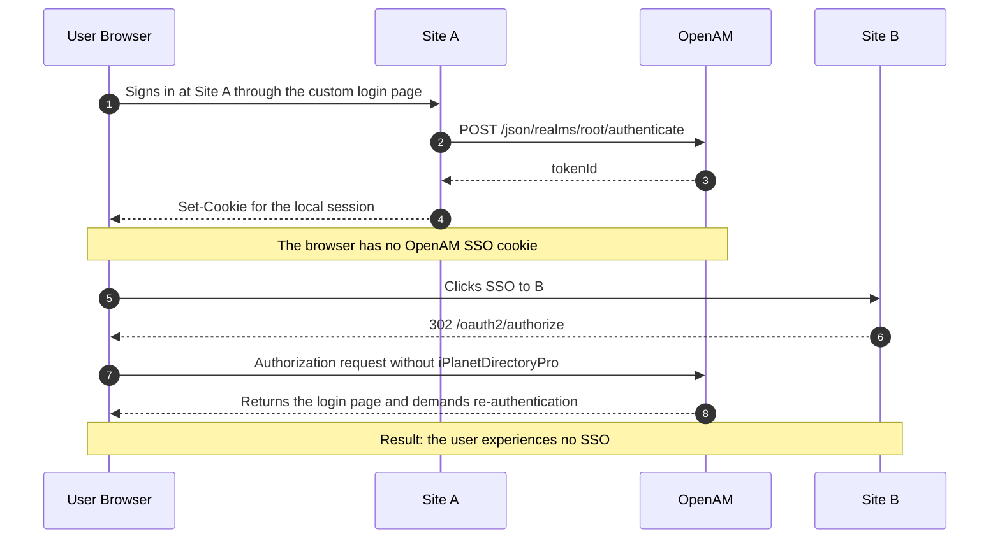
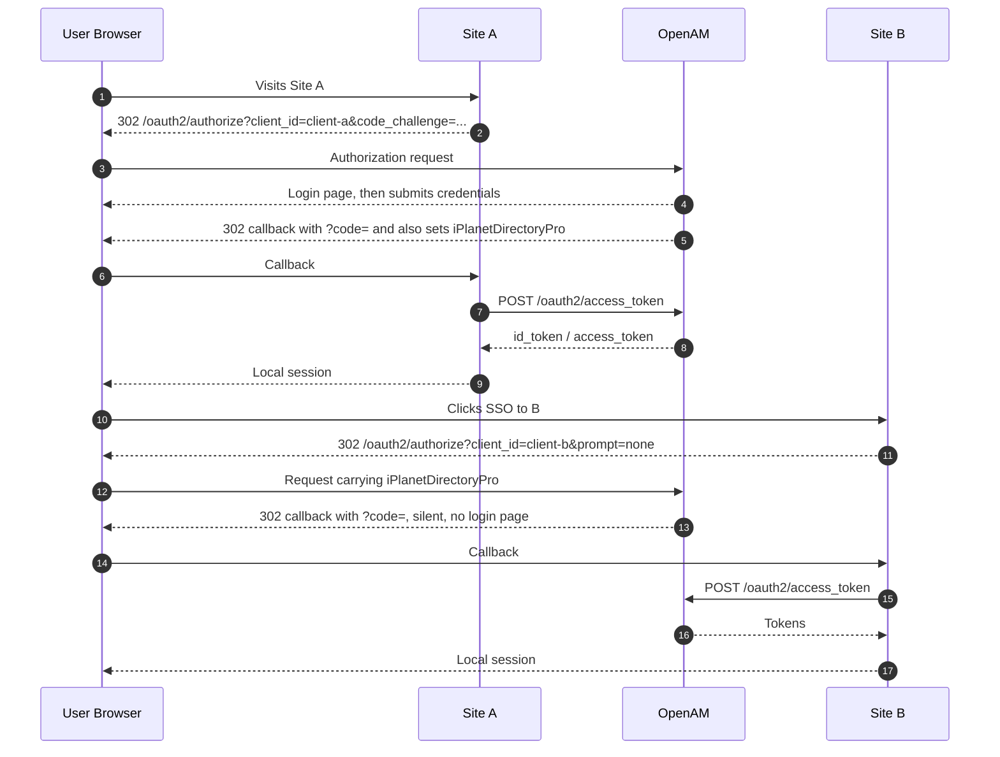
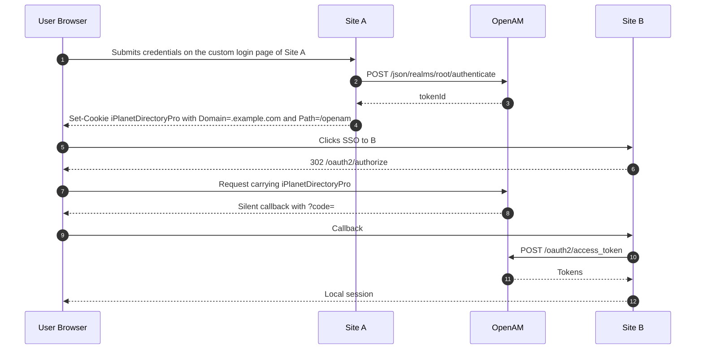
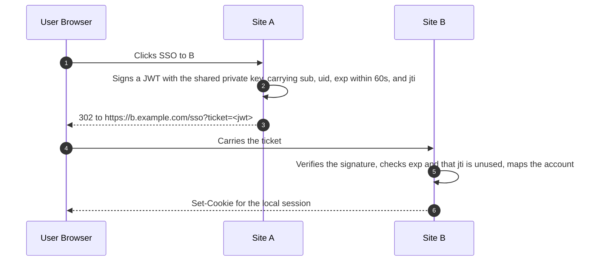

# OpenAM API in Practice: Single-Site Login and Cross-Site SSO

> Applies to: OpenIdentityPlatform OpenAM 16.1.4 deployed at `http://localhost:8090/openam`, with `root` as the default realm.
> Endpoints may differ slightly on other versions; always take the instance's `/.well-known/openid-configuration` as the source of truth.

## Contents

- [0. Build the API Map First](#0-build-the-api-map-first)
- [1. Scenario 1: Single-Site Login Without SSO](#1-scenario-1-single-site-login-without-sso)
- [2. Scenario 2: Site A Uses Option B, How to SSO to Site B](#2-scenario-2-site-a-uses-option-b-how-to-sso-to-site-b)
- [3. Key Constraints and Pitfalls](#3-key-constraints-and-pitfalls)
- [4. Minimal API Checklist](#4-minimal-api-checklist)
- [5. Reference Implementation in This Repository](#5-reference-implementation-in-this-repository)

---

## 0. Build the API Map First

The interfaces OpenAM exposes fall into four groups, and **each group plays a completely different role**. Mixing them up is the most common source of architectural mistakes.

| Group | Path prefix | Caller | Purpose | Requires admin |
| --- | --- | --- | --- | --- |
| OAuth2 / OIDC protocol endpoints | `/openam/oauth2/...` | Browser, site backend | Standard login authorization, tokens, user info | No |
| Authentication REST | `/openam/json/realms/{realm}/authenticate` | Site backend | Programmatic authentication, multi-step / MFA | No |
| Session REST | `/openam/json/realms/{realm}/sessions` | Site backend | Validate, renew, and log out sessions | No (requires a session token) |
| User and configuration REST | `/openam/json/realms/{realm}/users`, `/realm-config/...` | Ops scripts, provisioning | Create users, register clients, change service settings | Yes |

The key distinction comes down to one sentence:

- **`/oauth2/*` runs in the browser.** The user sees a login page, and OpenAM's SSO cookie (`iPlanetDirectoryPro`) is stored in the browser;
- **`/json/*` runs on the backend.** It is a server-to-server call, so the browser never gets that cookie.

Every SSO-related conclusion below follows from this.

---

## 1. Scenario 1: Single-Site Login Without SSO

When all you need is "a user logs in to this site", there are two mainstream approaches.

### 1.1 Option A: OIDC Authorization Code + PKCE (Most Common, Recommended)

#### Endpoint Checklist

| Priority | Endpoint | Method | Purpose |
| --- | --- | --- | --- |
| Required | `/openam/oauth2/.well-known/openid-configuration` | GET | Discovery document; the client fetches the remaining endpoints at startup |
| Required | `/openam/oauth2/authorize` | GET | Redirects to the OpenAM login page and returns with a `code` on success |
| Required | `/openam/oauth2/access_token` | POST | Exchanges `code` + `code_verifier` for `id_token` / `access_token` |
| Required | `/openam/oauth2/connect/jwk_uri` | GET | Fetches public keys to verify the `id_token` signature (cacheable) |
| Common | `/openam/oauth2/userinfo` | GET | Fetches extra details such as nickname and email (skippable when the ID Token already carries the claims) |
| Optional | `/openam/oauth2/connect/endSession` | GET | Logs the user out and clears the session on the RP side |

#### Sequence



#### Implementation Notes

- **PKCE is mandatory.** This project enables it on the client with `OAuth2AuthorizationRequestCustomizers.withPkce()`, and sets `codeVerifierEnforced` to `true` on the OpenAM side.
- **Validation.** Compare `state` to prevent CSRF, and verify `iss` / `aud` / `exp` / `nonce` in the `id_token`.
- **Token format.** This project sets `statelessTokensEnabled=true`, so the Access Token is an RS256-signed JWT that resource servers can verify locally.
- **Spring Security** only needs `issuer-uri=http://localhost:8090/openam/oauth2`; discovery handles the rest of the configuration automatically.

#### Endpoints This Option Does Not Need

`introspect` (verify locally with JWKS instead), `checkSession`, `device/code`, `connect/register`, `sessions/*`, `realm-config/*` (the last one belongs to deployment-time configuration).

### 1.2 Option B: Call the Authentication REST API Directly with a Custom Login Page

This fits cases where "the login UI must be fully custom and the user must never be redirected to an OpenAM page".

#### Endpoint Checklist

| Endpoint | Method | Purpose |
| --- | --- | --- |
| `/openam/json/realms/root/authenticate` | POST | Submits username and password, returns a `tokenId` |
| `/openam/json/realms/root/sessions/{tokenId}?_action=validate` | POST | Validates whether the session is still valid |
| `/openam/json/realms/root/sessions?_action=logout` | POST | Logs the session out |
| `/openam/json/realms/root/users/{uid}?_fields=mail,cn` | GET | Reads the user profile (optional) |

#### Example Calls

```bash
# One-step authentication (credentials passed in headers)
curl -X POST 'http://localhost:8090/openam/json/realms/root/authenticate' \
  -H 'X-OpenAM-Username: alice' \
  -H 'X-OpenAM-Password: Passw0rd!' \
  -H 'Content-Type: application/json' \
  -d '{}'
# => {"tokenId":"IQAAAJ...","successUrl":"/openam/console","realm":"/"}

# Validate the session
curl -X POST 'http://localhost:8090/openam/json/realms/root/sessions/<tokenId>?_action=validate' \
  -H 'Content-Type: application/json' -d '{}'
# => {"valid":true,"uid":"alice","realm":"/"}
```

For multi-step authentication (MFA), the response returns an `authId` plus `callbacks`, and you keep POSTing to the same endpoint with the callback input.

#### Sequence



#### Trade-offs

- Your backend receives the user's plaintext password, so HTTPS is required end to end and the application becomes part of the password-handling security boundary.
- Session expiry, renewal, logout, and the MFA interaction all become your responsibility.
- These are OpenAM-proprietary interfaces, so a future migration means a rewrite.

### 1.3 Choosing Between the Two Options

| Dimension | Option A (OIDC) | Option B (Authentication REST) |
| --- | --- | --- |
| Who handles the password | Entered only on the OpenAM page | The site backend receives it |
| Standards compliance | Standard protocol, works with any OIDC client library | OpenAM-proprietary interfaces |
| Amount of code | About 10 lines of configuration | You must build login, session, logout, and expiry yourself |
| Session management | Only the local session | Both the `tokenId` and the local session |
| MFA | Handled by OpenAM automatically | You must implement the callbacks loop |
| Later SSO expansion | Supported out of the box | Requires rework (see Chapter 2) |

**Conclusion**: prefer Option A for single-site login. Choose Option B only if you truly need a fully custom login UI and can accept passwords passing through your backend. If you have no need for unified identity, MFA, or LDAP integration, you may not need OpenAM at all.

---

## 2. Scenario 2: Site A Uses Option B, How to SSO to Site B

### 2.1 Conclusion

**It can be done, but you must first satisfy one precondition: OpenAM's SSO session has to live in the browser, not only in the Site A backend.**

### 2.2 Why a Button Click Does Not Give You SSO Today

Authentication in Option B is server-to-server. The `tokenId` is stored only in Site A's session, and the browser has no `iPlanetDirectoryPro`.



**The test is simple**: open the OpenAM console directly at `http://localhost:8090/openam/console`, or inspect the cookies for OpenAM's domain in DevTools and look for `iPlanetDirectoryPro`. If you are still asked to log in, or the cookie is absent, the SSO session is not in the browser.

### 2.3 Path 1: Change Site A's Login Entry Point to a Browser Redirect (Recommended)

Even with a single application today, switch Site A's authentication from "call REST from the backend" to "send the browser to OpenAM" (OIDC authorization code). Site A's own session, user table, and business code stay untouched; only the login entry point changes.



#### Implementation Notes

1. Register B in OpenAM as a second `OAuth2Client`:

   ```bash
   PUT /json/realms/root/realm-config/agents/OAuth2Client/client-b
   ```

   Note that list attributes such as `redirectionURIs` and `scopes` must be encoded with the `[i]=` index prefix (see Chapter 3 for details).

2. Have B's entry point start a silent authorization request with `prompt=none`:

   ```text
   GET /oauth2/authorize?response_type=code&client_id=client-b
       &redirect_uri=https://b.example.com/login/oauth2/code/openam
       &scope=openid%20profile&state=...&prompt=none
   ```

3. Handle the "silent failure" case: when the OpenAM session is missing or has expired, the callback arrives with `error=login_required`. B should then redirect to its normal login page without showing an error, which is the standard behaviour.

4. Precondition: **A, B, and OpenAM do not need to share a domain.** SSO only depends on whether the browser sends `iPlanetDirectoryPro` when it reaches OpenAM. What actually needs checking is the cookie's `SameSite` (must not be `Strict`), `Secure` and `Path` attributes, plus a `redirect_uri` registered for each site's own domain.

> **On cookie domains (a common misconception)**
>
> The session belongs to OpenAM, not to A or B:
>
> ```text
> https://sso.example.com   <- the session cookie is only sent here
> https://site-a.com        <- only redirects the browser to sso.example.com
> https://site-b.net        <- only redirects the browser to sso.example.com
> ```
>
> When the user jumps from `site-b.net` to `sso.example.com/oauth2/authorize`, the request targets OpenAM, so the browser sends the cookie and SSO completes silently. Cross-top-level-domain and cross-company setups therefore work fine (in this project app1/app2 and OpenAM all live on localhost only because it simplifies local development — it is not a precondition).
>
> Conversely, even when all three share a parent domain, SSO still fails if the cookie is `SameSite=Strict`, the session has expired, or the browser blocks the cookie. `COOKIE_DOMAIN` is only needed when you want the cookie to cover multiple subdomains, which is a Path 2 concern.

#### Scope of Changes

| Change area | Details |
| --- | --- |
| Site A | Login entry becomes `302 /oauth2/authorize`; add callback handling; everything else stays the same |
| Site B | Register the client; add a `prompt=none` entry point plus a `login_required` fallback |
| OpenAM | Register one more `OAuth2Client`; verify the cookie's `SameSite` / `Secure` / `Path` settings |

### 2.4 Path 2: Keep Site A's Custom Login Page and Issue the SSO Cookie Yourself

Once Site A authenticates the user, it writes OpenAM's session cookie straight to the browser:

```http
Set-Cookie: iPlanetDirectoryPro=<tokenId>; Domain=.example.com; Path=/openam; Secure; HttpOnly; SameSite=Lax
```



#### Conditions You Must Verify

| Condition | Description |
| --- | --- |
| Shared parent domain | A and OpenAM must share a parent domain, otherwise the browser rejects the cookie |
| Cookie name | It may have been changed; the setting is `com.iplanet.am.cookie.name` |
| Path / Domain | Must match what OpenAM actually issues (usually `Path=/openam`) |
| Secure | Required in HTTPS environments |
| SameSite | `Lax` is enough for top-level navigation; cross-site iframe scenarios need `None` + `Secure` |
| Upgrade risk | If OpenAM enables cookie encryption, session IP binding, or similar hardening, this approach breaks and needs regression testing |

This path requires the smallest change, but it amounts to "carrying the session by hand", and its long-term maintenance cost is higher than Path 1.

### 2.5 Path 3: Skip OpenAM SSO and Use One-Time Tickets

After the user logs in at Site A and clicks the button, Site A issues a short-lived, single-use ticket. Site B validates it and creates a local session directly. This is **not real SSO** but trust delegation.



When it applies:

- B does not want to integrate with OpenAM at all (no client registration, no OIDC library) but is willing to trust Site A's identity.
- You only need "no login prompt for the hop from A to B", and B does not need to maintain an OpenAM session on its own.
- You need to pass along authorization details that only A knows (roles, tenant, business permissions) and that are not in OpenAM's claims.

Note: **crossing top-level domains is not a reason to pick it** — Path 1 already works across domains, because the session always lives on OpenAM's domain.

Trade-off: you have to maintain the account mapping yourself, and if B later needs other OpenAM capabilities, it will still hit the "not logged in to OpenAM" problem.

### 2.6 Comparing the Three Paths

| | Path 1: Site A switches to redirects | Path 2: Issue the SSO cookie | Path 3: One-time tickets |
| --- | --- | --- | --- |
| Real SSO? | Yes, via a standard protocol | Yes | No, this is trust delegation |
| Scope of change | Site A's login entry point | One extra response header after Site A authenticates | One endpoint on each of A and B |
| Cross-domain requirement | None (A/B need not share OpenAM's domain) | Must share the parent domain (A writes OpenAM's cookie) | None |
| Standards compliance | High | Low (relies on internals) | Medium (custom protocol) |
| Risk | Low | High, easily broken by security hardening | Medium, ticket security is on you |
| Recommendation | ★★★ | ★ | ★★ (when B does not integrate with OpenAM) |

---

## 3. Key Constraints and Pitfalls

Everything below comes from hands-on testing in this project.

| Symptom | Cause | Fix |
| --- | --- | --- |
| `redirect_uri_mismatch`, `unsupported_response_type`, empty logout URL | The agent's list attributes (`redirectionURIs`, `scopes`, `grantTypes`, etc.) were not written with the `[i]=` index prefix, so the configuration "reads back fine but is empty at runtime" | Always encode them as `[1]=value` when writing |
| A standalone resource server always gets `active=false` from `introspect` | OpenAM 16.1.4 requires the introspecting clientId to match the client that owns the token | Switch to JWT Access Tokens with local JWKS verification |
| Other applications still let the user in without a password after calling `endSession` | `/oauth2/connect/endSession` does not destroy OpenAM's SSO session | Also call `POST /json/realms/root/sessions?_action=logout` with `iPlanetDirectoryPro` |
| SSO does not work | The browser holds no valid `iPlanetDirectoryPro`: the login never went through a browser redirect, the session expired, or the cookie is blocked by `SameSite=Strict` / third-party cookie policies | Use Path 1; verify the cookie's `SameSite` / `Secure` / `Path` and the session lifetime |
| `prompt=none` returns an error immediately | No valid session on OpenAM | Catch `error=login_required` and fall back to the normal login |
| Exchanging the authorization code for tokens fails | `code_verifier` was not sent, or the client enforces PKCE | Check `codeVerifierEnforced` and the client implementation |

---

## 4. Minimal API Checklist

### Single-Site Login (Option A)

```text
GET  /.well-known/openid-configuration
GET  /oauth2/authorize
POST /oauth2/access_token
GET  /oauth2/connect/jwk_uri
```

Optional: `GET /oauth2/userinfo`, `GET /oauth2/connect/endSession`

### Moving from Option B to Cross-Site SSO

```text
(keep)  POST /json/realms/root/authenticate
(add)   GET  /oauth2/authorize              # Site A login entry
(add)   POST /oauth2/access_token           # Site A exchanges the code
(add)   GET  /oauth2/authorize?prompt=none  # Site B silent entry
(add)   POST /oauth2/access_token           # Site B exchanges the code
(opt.)  POST /json/realms/root/sessions?_action=logout   # Full logout
```

---

## 5. Reference Implementation in This Repository

| File | Contents |
| --- | --- |
| [README.md](../README.md) | Architecture, startup steps, and pitfalls |
| [tools/openam_setup.py](../tools/openam_setup.py) | Uses REST to configure the provider, register the 3 clients, and create the demo users |
| [client-app/](../client-app) | Two OIDC clients (8091 / 8092) demonstrating a shared SSO session |
| [resource-server/](../resource-server) | Verifies JWT Access Tokens locally with JWKS |

Key configuration properties (`realm-config/services/oauth-oidc`):

| Property | Value in this instance | Purpose |
| --- | --- | --- |
| `advancedOAuth2Config.codeVerifierEnforced` | `true` | Enforces PKCE |
| `coreOAuth2Config.statelessTokensEnabled` | `true` | Issues JWT Access Tokens |
| `advancedOAuth2Config.tokenSigningAlgorithm` | `RS256` | Token signing algorithm |
| `coreOAuth2Config.issueRefreshToken` | `true` | Allows refresh tokens |
| `advancedOAuth2Config.supportedScopes` | `openid`, `profile`, `email`, `message.read`, `message.write` | Available scopes |

---

OIDC endpoints of the current instance (useful for cross-checking):

```text
issuer                 http://localhost:8090/openam/oauth2
authorization_endpoint http://localhost:8090/openam/oauth2/authorize
token_endpoint         http://localhost:8090/openam/oauth2/access_token
userinfo_endpoint      http://localhost:8090/openam/oauth2/userinfo
jwks_uri               http://localhost:8090/openam/oauth2/connect/jwk_uri
end_session_endpoint   http://localhost:8090/openam/oauth2/connect/endSession
revocation_endpoint    http://localhost:8090/openam/oauth2/revoke
check_session_iframe   http://localhost:8090/openam/oauth2/connect/checkSession
device_authorization   http://localhost:8090/openam/oauth2/device/code
registration_endpoint  http://localhost:8090/openam/oauth2/connect/register
```
