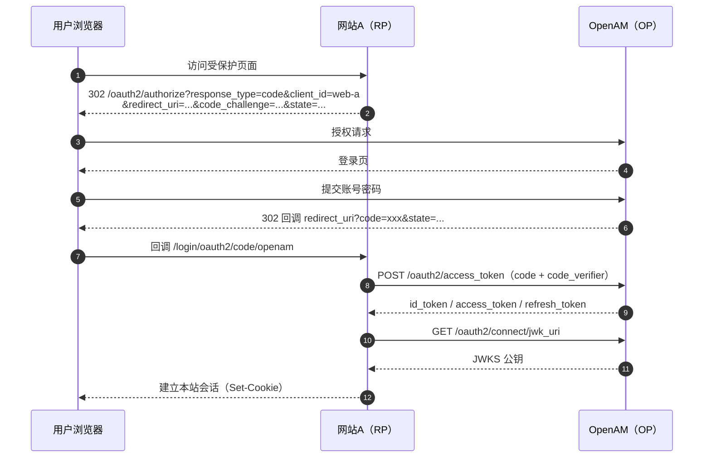
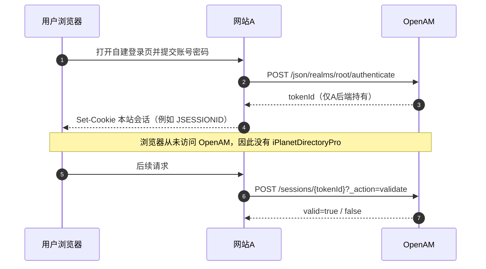
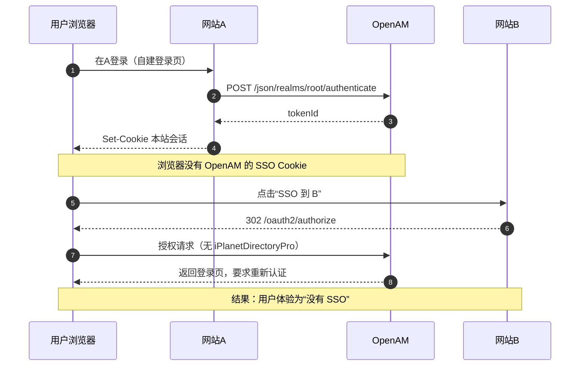
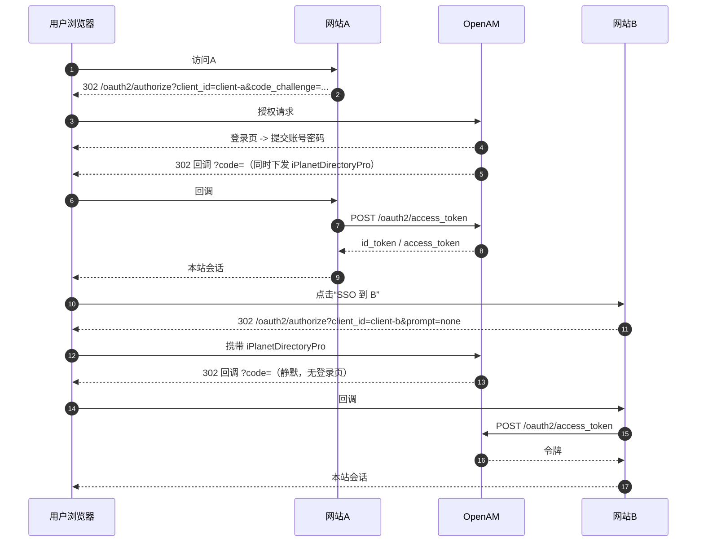
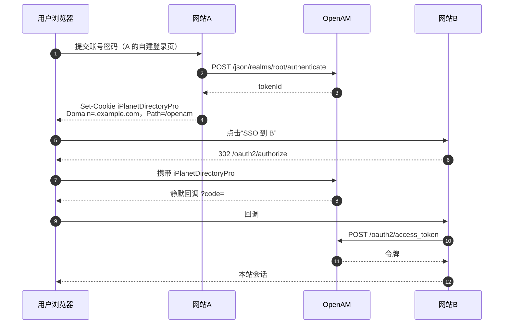
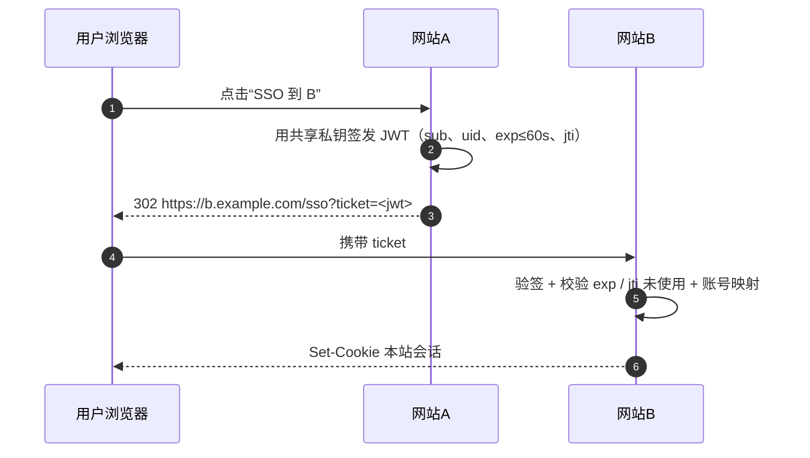

# OpenAM API 实战指南：单站登录与跨站 SSO

> 适用环境：OpenIdentityPlatform OpenAM 16.1.4，部署在 `http://localhost:8090/openam`，默认 Realm 为 `root`。
> 其他版本端点可能略有差异，请以实例的 `/.well-known/openid-configuration` 为准。

## 目录

- [0. 先建立 API 地图](#0-先建立-api-地图)
- [1. 场景一：只做单站登录，不需要 SSO](#1-场景一只做单站登录不需要-sso)
- [2. 场景二：网站 A 已用方案 B，如何点按钮 SSO 到网站 B](#2-场景二网站-a-已用方案-b如何点按钮-sso-到网站-b)
- [3. 关键约束与踩坑](#3-关键约束与踩坑)
- [4. 最小 API 清单](#4-最小-api-清单)
- [5. 本项目内的参考实现](#5-本项目内的参考实现)

---

## 0. 先建立 API 地图

OpenAM 对外暴露的接口可以分成四组，**承担的角色完全不同**，混用是最常见的架构错误来源。

| 组 | 路径前缀 | 调用方 | 用途 | 是否需要管理员 |
| --- | --- | --- | --- | --- |
| OAuth2 / OIDC 协议端点 | `/openam/oauth2/...` | 浏览器、网站后端 | 标准登录授权、令牌、用户信息 | 否 |
| 认证 REST | `/openam/json/realms/{realm}/authenticate` | 网站后端 | 编程式认证，多步/MFA | 否 |
| 会话 REST | `/openam/json/realms/{realm}/sessions` | 网站后端 | 校验、续期、注销会话 | 否（需会话 token） |
| 用户与配置 REST | `/openam/json/realms/{realm}/users`、`/realm-config/...` | 运维脚本、初始化 | 建用户、注册客户端、改服务参数 | 是 |

关键区别只有一句话：

- **`/oauth2/*` 走浏览器**，用户看得见登录页，OpenAM 的 SSO Cookie（`iPlanetDirectoryPro`）会落在浏览器上；
- **`/json/*` 走后端**，是服务端到服务端的调用，浏览器拿不到这个 Cookie。

后面所有与 SSO 相关的结论都源自这一点。

---

## 1. 场景一：只做单站登录，不需要 SSO

只有"用户登录这个网站"一个需求时，有两条主流做法。

### 1.1 方案 A：OIDC 授权码 + PKCE（最常见，推荐）

#### 端点清单

| 优先级 | 端点 | 方法 | 作用 |
| --- | --- | --- | --- |
| 必需 | `/openam/oauth2/.well-known/openid-configuration` | GET | 发现文档，客户端启动时自动获取其余端点 |
| 必需 | `/openam/oauth2/authorize` | GET | 跳转 OpenAM 登录页，成功后回跳带 `code` |
| 必需 | `/openam/oauth2/access_token` | POST | 用 `code` + `code_verifier` 换 `id_token` / `access_token` |
| 必需 | `/openam/oauth2/connect/jwk_uri` | GET | 获取公钥，校验 `id_token` 签名（可缓存） |
| 常用 | `/openam/oauth2/userinfo` | GET | 取昵称、邮箱等附加信息（ID Token 已有 claims 时可省） |
| 可选 | `/openam/oauth2/connect/endSession` | GET | 退出登录，清理 RP 侧会话 |

#### 时序



#### 实现要点

- **PKCE 必须开**：本项目在客户端用 `OAuth2AuthorizationRequestCustomizers.withPkce()`，OpenAM 侧把 `codeVerifierEnforced` 置为 `true`。
- **校验**：比对 `state` 防 CSRF；校验 `id_token` 的 `iss` / `aud` / `exp` / `nonce`。
- **令牌形态**：本项目开启 `statelessTokensEnabled=true`，Access Token 是 RS256 签名的 JWT，资源服务器可本地验签。
- **Spring Security** 只需配置 `issuer-uri=http://localhost:8090/openam/oauth2`，自动拉 discovery 完成配置。

#### 这个方案不需要用到的端点

`introspect`（用 JWKS 本地验签即可）、`checkSession`、`device/code`、`connect/register`、`sessions/*`、`realm-config/*`（后者属于部署期配置）。

### 1.2 方案 B：直接调认证 REST，自建登录页

适合"必须完全自定义登录 UI、不能跳转到 OpenAM 页面"的场景。

#### 端点清单

| 端点 | 方法 | 作用 |
| --- | --- | --- |
| `/openam/json/realms/root/authenticate` | POST | 提交用户名密码，返回 `tokenId` |
| `/openam/json/realms/root/sessions/{tokenId}?_action=validate` | POST | 校验会话是否有效 |
| `/openam/json/realms/root/sessions?_action=logout` | POST | 注销会话 |
| `/openam/json/realms/root/users/{uid}?_fields=mail,cn` | GET | 读取用户资料（可选） |

#### 调用示例

```bash
# 一步认证（凭据放在请求头）
curl -X POST 'http://localhost:8090/openam/json/realms/root/authenticate' \
  -H 'X-OpenAM-Username: alice' \
  -H 'X-OpenAM-Password: Passw0rd!' \
  -H 'Content-Type: application/json' \
  -d '{}'
# => {"tokenId":"IQAAAJ...","successUrl":"/openam/console","realm":"/"}

# 校验
curl -X POST 'http://localhost:8090/openam/json/realms/root/sessions/<tokenId>?_action=validate' \
  -H 'Content-Type: application/json' -d '{}'
# => {"valid":true,"uid":"alice","realm":"/"}
```

多步认证（MFA）时，响应会返回 `authId` + `callbacks`，后续继续 POST 同名接口提交 callback 输入。

#### 时序



#### 代价

- 你的后端会收到用户明文密码，必须全链路 HTTPS，且应用被纳入密码处理的安全边界。
- 会话过期、续期、注销、MFA 交互都要自己实现。
- 属于 OpenAM 私有接口，未来迁移需要重写。

### 1.3 两条路怎么选

| 维度 | 方案 A（OIDC） | 方案 B（认证 REST） |
| --- | --- | --- |
| 密码经手方 | 只在 OpenAM 页面输入 | 网站后端收到密码 |
| 标准性 | 标准协议，任意 OIDC 客户端库可用 | OpenAM 私有接口 |
| 代码量 | 约 10 行配置 | 需自建登录、会话、退出、过期 |
| 会话管理 | 只管本站会话 | 同时管 `tokenId` 和本站会话 |
| MFA | OpenAM 自动接管 | 需自己实现 callbacks 循环 |
| 后续扩展 SSO | 天然支持 | 需要改造（见第 2 章） |

**结论**：单站登录优先选方案 A。只有确实要完全自定义登录 UI、且能接受密码经过后端时，才选方案 B。如果连统一身份、MFA、LDAP 集成都没有需求，其实可以不引入 OpenAM。

---

## 2. 场景二：网站 A 已用方案 B，如何点按钮 SSO 到网站 B

### 2.1 结论

**可以实现，但必须先解决一个前提：OpenAM 的 SSO 会话要存在于浏览器，而不是只在网站 A 的后端。**

### 2.2 为什么现状下点按钮不会免登录

方案 B 的认证是服务端到服务端的，`tokenId` 只保存在 A 的会话里，浏览器手里没有 `iPlanetDirectoryPro`。



**判断标准很简单**：在浏览器里直接访问 OpenAM 控制台（`http://localhost:8090/openam/console`），或在 DevTools 的 Cookies 里查看 OpenAM 域名下是否存在 `iPlanetDirectoryPro`。若仍要求登录 / 没有该 Cookie，说明 SSO 会话不在浏览器上。

### 2.3 路径 1：把 A 的登录入口改成浏览器重定向（推荐）

即使当前只有一个应用，也把 A 的认证方式从"后端调 REST"改成"浏览器跳 OpenAM"（OIDC 授权码）。A 自己的 session、用户表、业务代码都不用动，只换登录入口那一步。



#### 实现要点

1. 在 OpenAM 中把 B 注册为第二个 `OAuth2Client`：

   ```bash
   PUT /json/realms/root/realm-config/agents/OAuth2Client/client-b
   ```

   注意 `redirectionURIs`、`scopes` 等列表属性必须用 `[i]=` 索引前缀编码（详见第 3 章）。

2. B 的入口用 `prompt=none` 发起静默授权：

   ```text
   GET /oauth2/authorize?response_type=code&client_id=client-b
       &redirect_uri=https://b.example.com/login/oauth2/code/openam
       &scope=openid%20profile&state=...&prompt=none
   ```

3. 处理"静默失败"：OpenAM 会话不存在或已过期时，会回调 `error=login_required`。B 收到后应自动跳转到普通登录页（不弹错误），这是标准做法。

4. 前提条件：**A、B 与 OpenAM 不需要同一个域名**。SSO 只取决于浏览器访问 OpenAM 时能否带上 `iPlanetDirectoryPro`；真正要核对的是 Cookie 的 `SameSite`（不能是 `Strict`）、`Secure`、`Path`，以及 A、B 各自的 `redirect_uri` 已注册到自己的域名。

> **关于 Cookie 域（常见误解）**
>
> 会话的归属是 OpenAM，不是 A 或 B：
>
> ```text
> https://sso.example.com   ← 会话 Cookie 只发给这里
> https://site-a.com        ← 只负责 302 到 sso.example.com
> https://site-b.net        ← 只负责 302 到 sso.example.com
> ```
>
> 用户从 `site-b.net` 跳转到 `sso.example.com/oauth2/authorize`，请求的目标站点是 OpenAM，浏览器会正常携带 Cookie，SSO 静默完成。因此跨顶级域、跨企业都能用（本项目 app1/app2 与 OpenAM 同在 localhost，只是本地开发省事，不是前提）。
>
> 反过来，即使三者在同一父域下，只要 Cookie 是 `SameSite=Strict`、会话已过期，或被浏览器拦截，SSO 一样会失败。需要配置 `COOKIE_DOMAIN` 的场合是"想让 Cookie 覆盖多个子域"，那属于路径 2 的诉求。

#### 改动量

| 改动点 | 内容 |
| --- | --- |
| 网站 A | 登录入口改为 `302 /oauth2/authorize`；新增回调处理；其余业务不变 |
| 网站 B | 注册客户端；新增 `prompt=none` 入口 + `login_required` 回落 |
| OpenAM | 新增一个 `OAuth2Client`；核对 Cookie 的 `SameSite` / `Secure` / `Path` |

### 2.4 路径 2：保留 A 的自建登录页，主动下发 SSO Cookie

A 认证成功后，把 OpenAM 的会话 Cookie 直接写给浏览器：

```http
Set-Cookie: iPlanetDirectoryPro=<tokenId>; Domain=.example.com; Path=/openam; Secure; HttpOnly; SameSite=Lax
```



#### 必须核对的条件

| 条件 | 说明 |
| --- | --- |
| 同父域 | A 与 OpenAM 必须共享父域，否则浏览器拒收该 Cookie |
| Cookie 名 | 可能被改过，配置项是 `com.iplanet.am.cookie.name` |
| Path / Domain | 必须与 OpenAM 实际下发的一致（通常是 `Path=/openam`） |
| Secure | HTTPS 环境必须带 |
| SameSite | 顶层跳转用 `Lax` 即可；跨站 iframe 场景需要 `None` + `Secure` |
| 升级风险 | OpenAM 若启用 Cookie 加密、会话绑定 IP 等加固，此方案会失效，需要回归测试 |

这个方案改动最小，但属于"手工搬运会话"，长期维护成本高于路径 1。

### 2.5 路径 3：不做 OpenAM SSO，改用一次性票据

A 登录后，用户点按钮时由 A 签发一张短期一次性票据，B 校验后直接建本地会话。这**不是真正的 SSO**，而是信任传递。



适用条件：

- B 不想接入 OpenAM（不注册客户端、不引入 OIDC 库），但愿意信任 A 的身份。
- 只需要"从 A 跳到 B 时免登录一次"，不要求 B 独立维持 OpenAM 会话。
- 需要在跳转时附带 A 特有的授权信息（角色、租户、业务权限），这些不在 OpenAM 的 claims 里。

注意：**跨顶级域并不是选它的理由**——路径 1 本身就支持跨域，因为会话始终在 OpenAM 域名下。

代价：账号映射要自己维护；如果 B 之后还要访问 OpenAM 的其他能力，仍会遇到"OpenAM 未登录"的问题。

### 2.6 三条路径对比

| | 路径 1：A 改走重定向 | 路径 2：下发 SSO Cookie | 路径 3：一次性票据 |
| --- | --- | --- | --- |
| 是否真正 SSO | 是，标准协议 | 是 | 否，属信任传递 |
| 改动范围 | A 的登录入口 | A 认证成功后加一行响应头 | A、B 各加一个接口 |
| 跨域要求 | 无（A/B 无需与 OpenAM 同域） | 必须同父域（A 要代写 OpenAM 的 Cookie） | 无 |
| 标准性 | 高 | 低（依赖内部实现） | 中（自定义协议） |
| 风险 | 低 | 高，易受安全加固影响 | 中，需自行保证票据安全 |
| 推荐度 | ★★★ | ★ | ★★（B 不接 OpenAM 时） |

---

## 3. 关键约束与踩坑

以下均来自本项目的实测记录。

| 现象 | 原因 | 对策 |
| --- | --- | --- |
| `redirect_uri_mismatch`、`unsupported_response_type`、登出地址为空 | Agent 的 list 属性（`redirectionURIs`、`scopes`、`grantTypes` 等）未使用 `[i]=` 索引前缀，配置"读得到、运行时为空" | 写入时统一编码为 `[1]=value` 形式 |
| 独立资源服务器调 `introspect` 总是 `active=false` | OpenAM 16.1.4 要求自省方 clientId 与令牌所属客户端一致 | 改用 JWT Access Token + JWKS 本地验签 |
| 调 `endSession` 后仍能免密进入其他应用 | `/oauth2/connect/endSession` 不会销毁 OpenAM 的 SSO 会话 | 追加 `POST /json/realms/root/sessions?_action=logout`（带 `iPlanetDirectoryPro`） |
| SSO 不生效 | 浏览器没有有效的 `iPlanetDirectoryPro`：未走浏览器重定向、会话过期，或被 `SameSite=Strict` / 第三方 Cookie 策略拦截 | 使用路径 1；核对 Cookie 的 `SameSite` / `Secure` / `Path` 与会话有效期 |
| `prompt=none` 直接报错 | OpenAM 无有效会话 | 捕获 `error=login_required` 并回落普通登录 |
| 授权码换令牌失败 | 未发送 `code_verifier`，或客户端强制了 PKCE | 检查 `codeVerifierEnforced` 与客户端实现 |

---

## 4. 最小 API 清单

### 单站登录（方案 A）

```text
GET  /.well-known/openid-configuration
GET  /oauth2/authorize
POST /oauth2/access_token
GET  /oauth2/connect/jwk_uri
```

可选：`GET /oauth2/userinfo`、`GET /oauth2/connect/endSession`

### 从方案 B 演进到跨站 SSO

```text
（保持）POST /json/realms/root/authenticate
（新增）GET  /oauth2/authorize              # A 的登录入口
（新增）POST /oauth2/access_token           # A 换令牌
（新增）GET  /oauth2/authorize?prompt=none  # B 的静默入口
（新增）POST /oauth2/access_token           # B 换令牌
（可选）POST /json/realms/root/sessions?_action=logout   # 彻底登出
```

---

## 5. 本项目内的参考实现

| 文件 | 内容 |
| --- | --- |
| [README.md](../README.md) | 架构、启动步骤、踩坑记录 |
| [tools/openam_setup.py](../tools/openam_setup.py) | 通过 REST 完成 Provider 配置、3 个客户端注册、演示用户创建 |
| [client-app/](../client-app) | 两个 OIDC 客户端（8091 / 8092），演示共享 SSO 会话 |
| [resource-server/](../resource-server) | 用 JWKS 本地验签 JWT Access Token |

关键配置项（`realm-config/services/oauth-oidc`）：

| 属性 | 本实例取值 | 作用 |
| --- | --- | --- |
| `advancedOAuth2Config.codeVerifierEnforced` | `true` | 强制 PKCE |
| `coreOAuth2Config.statelessTokensEnabled` | `true` | 签发 JWT Access Token |
| `advancedOAuth2Config.tokenSigningAlgorithm` | `RS256` | 令牌签名算法 |
| `coreOAuth2Config.issueRefreshToken` | `true` | 允许刷新令牌 |
| `advancedOAuth2Config.supportedScopes` | `openid`、`profile`、`email`、`message.read`、`message.write` | 可用 scope |

---

当前实例的 OIDC 端点（可直接用于对照）：

```text
issuer                 http://localhost:8090/openam/oauth2
authorization_endpoint http://localhost:8090/openam/oauth2/authorize
token_endpoint         http://localhost:8090/openam/oauth2/access_token
userinfo_endpoint      http://localhost:8090/openam/oauth2/userinfo
jwks_uri               http://localhost:8090/openam/oauth2/connect/jwk_uri
end_session_endpoint   http://localhost:8090/openam/oauth2/connect/endSession
revocation_endpoint    http://localhost:8090/openam/oauth2/revoke
check_session_iframe   http://localhost:8090/openam/oauth2/connect/checkSession
device_authorization   http://localhost:8090/openam/oauth2/device/code
registration_endpoint  http://localhost:8090/openam/oauth2/connect/register
```
